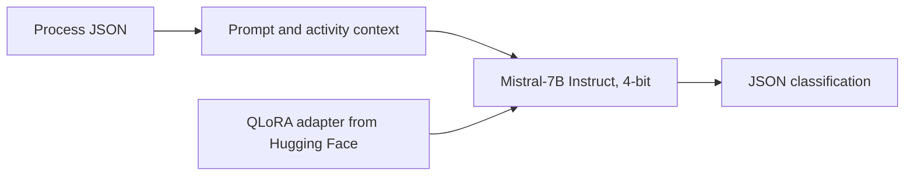

# Lean Value-Added Analysis with Mistral-7B QLoRA

A local demo for automating Value-Added Analysis (VAA), a process analysis technique in Business Process Management (BPM). The project uses a QLoRA adapter fine-tuned on Mistral-7B-Instruct-v0.3 to classify business-process activities and return structured JSON output.

## Model and Adapter

- Fine-tuned adapter: [ridoley/mistral7b-vaa-general-qlora](https://huggingface.co/ridoley/mistral7b-vaa-general-qlora)
- Base model: [`mistralai/Mistral-7B-Instruct-v0.3`](https://huggingface.co/mistralai/Mistral-7B-Instruct-v0.3)

Accept the base model's license on Hugging Face before downloading it.

## Classification Labels

| Label | Description |
| --- | --- |
| **VA** | The activity directly contributes to the outcome requested by the customer. |
| **BVA** | The activity is required for business operations, control, or compliance. |
| **NVA** | The activity does not add value and may represent waste. |

For NVA activities, the model also assigns a waste type from TIMWOODS: Defects, Overproduction, Waiting, Unused Talent, Transportation, Inventory, Motion, or Extra-processing.

## Inference Workflow

The app combines the process description with activity-level context, sends it to Mistral-7B with the QLoRA adapter, and parses the generated response into JSON.



The adapter uses the following configuration:

| Setting | Value |
| --- | --- |
| Fine-tuning method | QLoRA (NF4) with LoRA |
| Rank (`r`) | 16 |
| LoRA alpha | 32 |
| Dropout | 0.05 |
| Target modules | `q_proj`, `k_proj`, `v_proj`, `o_proj`, `gate_proj`, `up_proj`, `down_proj` |

## Requirements

- Python environment supported by the packages in `requirements.txt`
- NVIDIA GPU with CUDA support
- Around 8–12 GB of VRAM is recommended for 4-bit inference; actual usage depends on the runtime and input length
- Around 15 GB of free disk space for the base-model cache on the first run

CPU-only execution is not supported by this demo setup.

## Installation

Clone the repository and create a virtual environment:

```bash
git clone https://github.com/<your-username>/<your-repo>.git
cd <your-repo>
python -m venv .venv
```

Activate the environment and install the dependencies.

**Windows (PowerShell):**

```powershell
.venv\Scripts\activate
pip install -r requirements.txt
copy .env.example .env
```

**Linux / macOS:**

```bash
source .venv/bin/activate
pip install -r requirements.txt
cp .env.example .env
```

### Hugging Face Access

1. Create a Hugging Face access token with **Read** permission at [Hugging Face Settings](https://huggingface.co/settings/tokens).
2. Open the [base model page](https://huggingface.co/mistralai/Mistral-7B-Instruct-v0.3) and accept its license.
3. Add the token to your `.env` file:

```env
HF_TOKEN=hf_...
```

Keep the token private. Do not commit `.env` to GitHub.

## Run the CLI Demo

Run inference on the example process:

```powershell
python infer.py --input examples/goods_delivery.json
```

The result is printed in the terminal and saved to `outputs/last_result.json`.

### Example Input

```json
{
  "process_name": "Goods Delivery Process",
  "activities": [
    {
      "activity_name": "Receive goods from customer",
      "description": "The customer's goods are accepted into the delivery service."
    }
  ]
}
```

### Example Output

```json
{
  "process_name": "Goods Delivery Process",
  "activities": [
    {
      "activity_name": "Receive goods from customer",
      "label": "VA",
      "waste_type": "",
      "justification": "..."
    }
  ]
}
```

For the expected output structure, see `examples/expected_schema.json`.

## Run the Web Interface

Start the Gradio app:

```powershell
python app.py
```

Open the local URL shown in the terminal. You can use the example process or edit it, then select **Classify process** to run the classification.

## Notes

- This repository contains the inference app, prompt, parser, and Gradio interface. The base model and adapter are downloaded separately.
- The adapter is hosted on [Hugging Face](https://huggingface.co/ridoley/mistral7b-vaa-general-qlora); the Mistral base model is loaded in 4-bit.
- Check the base model's license and terms before redistributing or deploying it.

---

## Overall Performance

Evaluated on 253 real-world business-process activities, the QLoRA fine-tuned model achieved 79.05% accuracy and a 76.86% Macro F1-score, outperforming the unadapted Mistral-7B-Instruct-v0.3, Gemini 2.5 Flash Lite, and Llama 3.3 70B baselines. Compared with the base Mistral-7B model, Macro F1 improved by 18.74 percentage points and accuracy improved by 10.67 percentage points.

| Model | Accuracy | Macro F1 |
| --- | ---: | ---: |
| Mistral-7B-Instruct-v0.3 (base) | 68.38% | 58.12% |
| Gemini 2.5 Flash Lite | 66.01% | 63.08% |
| Llama 3.3 70B | 69.17% | 67.19% |
| Mistral-7B-Instruct-v0.3 + QLoRA | **79.05%** | **76.86%** |

For the full methodology, detailed evaluation, error analysis, and limitations, see the published paper: [**Automating Value-Added Analysis in Business Processes Using a QLoRA Fine-Tuned Small Language Model — IEEE Xplore**](https://ieeexplore.ieee.org/document/11715129).

*Results are specific to this 253-activity test set; performance may differ on other datasets and business-process domains.*
