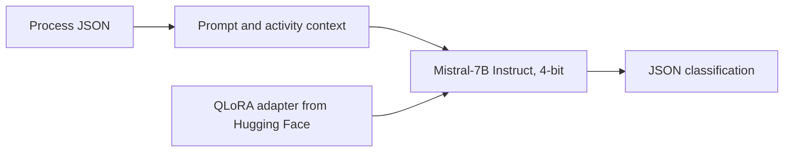

# Lean Value-Added Analysis with Mistral-7B QLoRA

A small local demo for classifying business-process activities as value-adding (VA), business value-adding (BVA), or non-value-adding (NVA). It uses a QLoRA adapter trained on top of Mistral-7B-Instruct and returns the result as JSON.

The adapter is available on Hugging Face: [ridoley/mistral7b-vaa-general-qlora](https://huggingface.co/ridoley/mistral7b-vaa-general-qlora).

The base model is [`mistralai/Mistral-7B-Instruct-v0.3`](https://huggingface.co/mistralai/Mistral-7B-Instruct-v0.3). You must accept its license on Hugging Face before downloading it.

## Classification labels

| Label | Description |
| --- | --- |
| **VA** | The activity directly contributes to the outcome requested by the customer. |
| **BVA** | The activity is required for business operations, control, or compliance. |
| **NVA** | The activity does not add value and may represent waste. |

For NVA activities, the model also assigns a waste type from TIMWOODS: Defects, Overproduction, Waiting, Unused talent, Transportation, Inventory, Motion, or Extra-processing.

## How it works

The app combines the process description with an activity-level prompt, sends it to Mistral-7B with the QLoRA adapter, and parses the generated response into JSON.



The adapter uses the following configuration:

| Setting | Value |
| --- | --- |
| Fine-tuning method | QLoRA (NF4) with LoRA |
| Rank (`r`) | 16 |
| LoRA alpha | 32 |
| Dropout | 0.05 |
| Target modules | `q_proj`, `k_proj`, `v_proj`, `o_proj`, `gate_proj`, `up_proj`, `down_proj` |

## Requirements

- Python environment supported by the packages in `requirements.txt`
- NVIDIA GPU with CUDA support
- Around 8–12 GB of VRAM is recommended for 4-bit inference; actual usage depends on the runtime and input length
- Around 15 GB of free disk space for the base-model cache on the first run

CPU-only execution is not supported by this demo setup.

## Setup

Clone the repository and create a virtual environment:

```bash
git clone https://github.com/<your-username>/<your-repo>.git
cd <your-repo>
python -m venv .venv
```

Activate the environment and install the dependencies.

**Windows (PowerShell):**

```powershell
.venv\Scripts\activate
pip install -r requirements.txt
copy .env.example .env
```

**Linux / macOS:**

```bash
source .venv/bin/activate
pip install -r requirements.txt
cp .env.example .env
```

### Hugging Face access

1. Create a Hugging Face access token with **Read** permission at [Hugging Face Settings](https://huggingface.co/settings/tokens).
2. Open the [base model page](https://huggingface.co/mistralai/Mistral-7B-Instruct-v0.3) and accept its license.
3. Add the token to your `.env` file:

```env
HF_TOKEN=hf_...
```

Keep the token private. Do not commit `.env` to GitHub.

## Run the command-line demo

Run inference on the example process:

```powershell
python infer.py --input examples/goods_delivery.json
```

The result is printed in the terminal and saved to `outputs/last_result.json`.

### Example input

```json
{
  "process_name": "Goods Delivery Process",
  "activities": [
    {
      "activity_name": "Receive goods from customer",
      "description": "The customer's goods are accepted into the delivery service."
    }
  ]
}
```

### Example output

```json
{
  "process_name": "Goods Delivery Process",
  "activities": [
    {
      "activity_name": "Receive goods from customer",
      "label": "VA",
      "waste_type": "",
      "justification": "..."
    }
  ]
}
```

For the expected output structure, see `examples/expected_schema.json`.

## Run the web interface

Start the Gradio app:

```powershell
python app.py
```

Open the local URL shown in the terminal. You can use the example process or edit it, then select **Classify process** to run the classification.

## Project structure

```text
vaa_qlora_portfolio/
├── README.md
├── LICENSE
├── requirements.txt
├── .env.example
├── infer.py
├── app.py
├── prompts/
│   └── system_prompt.txt
├── examples/
│   ├── goods_delivery.json
│   └── expected_schema.json
└── src/vaa_qlora/
    ├── engine.py
    ├── prompt.py
    └── parse.py
```

- `infer.py` runs inference from the command line.
- `app.py` starts the Gradio interface.
- `prompts/system_prompt.txt` contains the classification instructions.
- `src/vaa_qlora/engine.py` loads the base model and adapter and generates a response.
- `src/vaa_qlora/prompt.py` builds the process and activity context.
- `src/vaa_qlora/parse.py` parses the response and normalizes labels and waste types.

## Publish to GitHub

If you want to publish this folder as a separate repository, run these commands from the project directory:

```powershell
git init
git add .
git commit -m "Add VAA QLoRA inference demo"
gh repo create mistral7b-vaa-qlora-demo --public --source=. --remote=origin --push
```

If you do not use GitHub CLI (`gh`), create an empty repository on GitHub and run:

```powershell
git remote add origin https://github.com/<your-username>/<your-repo>.git
git branch -M main
git push -u origin main
```

Check `.gitignore` before pushing. Do not commit `.env`, access tokens, or downloaded model weights.

## Notes

- This repository contains the inference app, prompt, parser, and Gradio interface. The base model and adapter are downloaded separately.
- The adapter is available from [Hugging Face](https://huggingface.co/ridoley/mistral7b-vaa-general-qlora); the Mistral base model is loaded in 4-bit.
- The code repository uses the license specified in `LICENSE`. Check the base model's license and terms separately before redistributing or deploying it.
