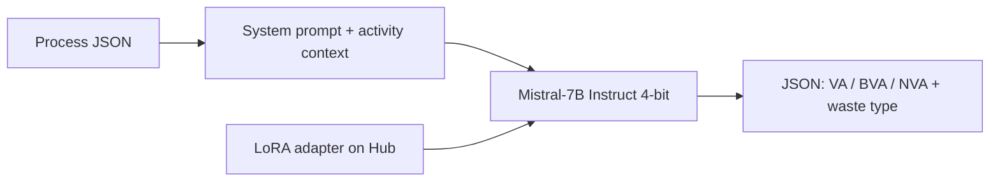

# Lean Value-Adding Analysis with Mistral-7B QLoRA

Standalone inference demo for a **QLoRA adapter** that classifies business-process activities into Lean categories:

| Label | Meaning |
| --- | --- |
| **VA** | Value-adding — directly transforms the customer-requested outcome |
| **BVA** | Business value-adding — needed for compliance, control, or operations |
| **NVA** | Non-value-adding — TIMWOODS waste that can be removed |

Adapter on Hugging Face (public):  
**[ridoley/mistral7b-vaa-general-qlora](https://huggingface.co/ridoley/mistral7b-vaa-general-qlora)**

Base model: [`mistralai/Mistral-7B-Instruct-v0.3`](https://huggingface.co/mistralai/Mistral-7B-Instruct-v0.3) (gated — accept the license on that page).

This folder is a **full demo** (CLI + Gradio + parser). Most people who only want the adapter do **not** need it. They can copy the snippet on the [Hub model card](https://huggingface.co/ridoley/mistral7b-vaa-general-qlora) or run `python quickstart.py`.

---

## What this project shows

- Parameter-efficient fine-tuning (**QLoRA / LoRA**, rank 16, alpha 32) instead of full 7B fine-tuning
- Instruction-style Lean/BPM classification with a structured JSON schema
- 4-bit NF4 inference with PEFT (`PeftModel.from_pretrained`)
- CLI + Gradio UI you can run locally on a consumer GPU



Adapter config (from the Hub repo):

| Setting | Value |
| --- | --- |
| Method | QLoRA NF4 + LoRA |
| Rank `r` | 16 |
| LoRA alpha | 32 |
| Dropout | 0.05 |
| Targets | `q_proj`, `k_proj`, `v_proj`, `o_proj`, `gate_proj`, `up_proj`, `down_proj` |

---

## Hardware

| Item | Minimum |
| --- | --- |
| GPU | NVIDIA CUDA, about **8–12 GB VRAM** (4-bit Mistral-7B) |
| Disk | ~15 GB for the base model cache (first run) |
| OS | Windows / Linux with recent PyTorch + CUDA |

CPU-only machines cannot run this demo as packaged.

---

## Setup

```bash
git clone https://github.com/<your-username>/<your-repo>.git
cd <your-repo>
python -m venv .venv
```

Windows:

```powershell
.venv\Scripts\activate
pip install -r requirements.txt
copy .env.example .env
```

Linux / macOS:

```bash
source .venv/bin/activate
pip install -r requirements.txt
cp .env.example .env
```

1. Create a Hugging Face token with **Read** access: [huggingface.co/settings/tokens](https://huggingface.co/settings/tokens)
2. Open [Mistral-7B-Instruct-v0.3](https://huggingface.co/mistralai/Mistral-7B-Instruct-v0.3) and accept the license
3. Put the token in `.env`:

```env
HF_TOKEN=hf_...
```

---

## Run the CLI

```powershell
python infer.py --input examples/goods_delivery.json
```

Output is printed and saved to `outputs/last_result.json`.

Input schema:

```json
{
  "process_name": "Goods Delivery Process",
  "activities": [
    {
      "activity_name": "Receive goods from customer",
      "description": "The customer's goods are accepted into the delivery service."
    }
  ]
}
```

Output schema (see also `examples/expected_schema.json`):

```json
{
  "process_name": "Goods Delivery Process",
  "activities": [
    {
      "activity_name": "Receive goods from customer",
      "label": "VA",
      "waste_type": "",
      "justification": "..."
    }
  ]
}
```

For **NVA**, `waste_type` is one of: Defects, Overproduction, Waiting, Unused talent, Transportation, Inventory, Motion, Extra-processing.

---

## Run the Gradio UI

```powershell
python app.py
```

Open the local URL shown in the terminal, keep or edit the example process, then click **Classify process**.

---

## Project layout

```text
vaa_qlora_portfolio/
├── README.md
├── LICENSE                 # Apache-2.0
├── requirements.txt
├── .env.example
├── infer.py                # command-line inference
├── app.py                  # Gradio demo
├── prompts/system_prompt.txt
├── examples/
│   ├── goods_delivery.json
│   └── expected_schema.json
└── src/vaa_qlora/
    ├── engine.py           # load base + adapter, generate
    ├── prompt.py           # process-flow prompt (same design as training)
    └── parse.py            # JSON recovery + label / waste normalisation
```

---

## Publish this folder as its own GitHub repo

From this directory:

```powershell
cd vaa_qlora_portfolio
git init
git add .
git commit -m "Add Mistral-7B VAA QLoRA inference demo"
gh repo create mistral7b-vaa-qlora-demo --public --source=. --remote=origin --push
```

Without `gh`:

1. Create an empty public repository on GitHub (no README)
2. Then:

```powershell
git remote add origin https://github.com/<your-username>/<your-repo>.git
git branch -M main
git push -u origin main
```

Do not commit `.env` or downloaded weights. `.gitignore` already excludes them.

---

## Notes for recruiters / reviewers

- Weights live on the Hub; this repo is the **application layer** (prompt, parser, inference, UI).
- The adapter is LoRA-only (~160 MB). The 7B base model is loaded in 4-bit and is **not** redistributed here.
- The system prompt matches the training setup: full process context, JSON-only output, TIMWOODS waste types for NVA.
- License: Apache-2.0 for this code, consistent with Mistral-7B-Instruct-v0.3.

---

## Bahasa Indonesia (ringkas)

Folder ini adalah **demo inferensi mandiri** untuk adapter QLoRA yang sudah diunggah ke Hugging Face. Anda bisa menyalin seluruh folder `vaa_qlora_portfolio/` ke repository GitHub baru sebagai portofolio.

1. Isi `HF_TOKEN` di `.env` dan terima lisensi Mistral di Hugging Face.
2. Jalankan `python infer.py` atau `python app.py` (butuh GPU NVIDIA).
3. Inisialisasi git di dalam folder ini, lalu push ke GitHub (langkah di atas).
